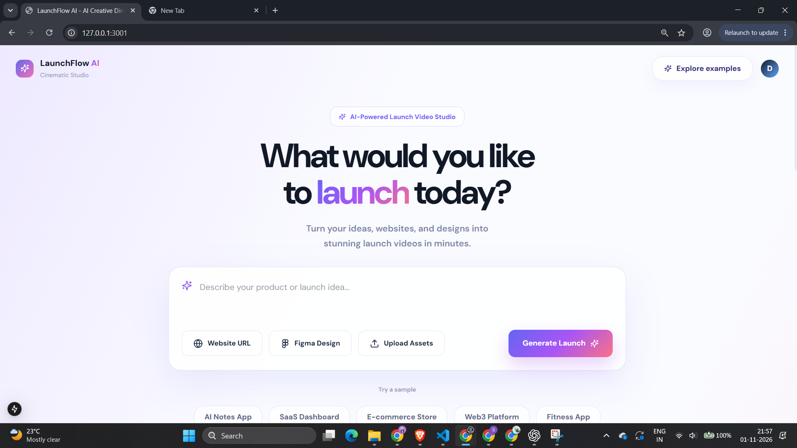
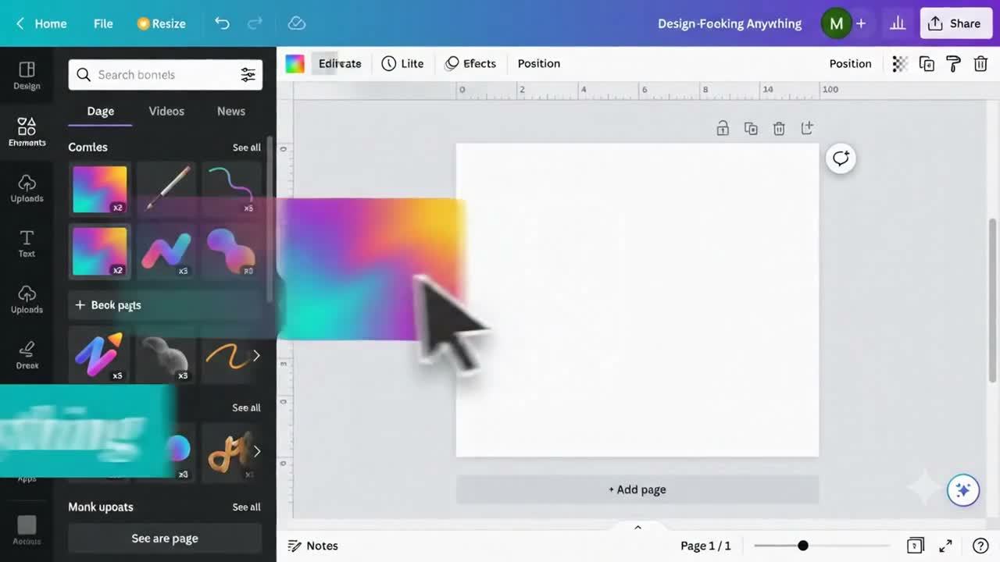

<div align="center">


# LaunchFlow AI

**Give your product a memorable entrance.**

A creative video prototype that turns a product idea into a refined launch prompt, visual direction, and a provider-generated video.


[Explore the interface](#interface) · [Sample films](#sample-films) · [Run locally](#run-locally)

</div>

## The Idea

Launching a product starts with a story. LaunchFlow brings the brief, creative direction, prompt preparation, and video preview into a single workspace.

Start with something simple:

> I want an advertisement for a mango drink company.

Choose a direction, apply a more descriptive prompt, and send the result to Google Veo. The interface shows preparation stages and reports provider failures clearly.

## Interface



*Homepage preview. Branding and decorative details may differ slightly from the latest local version.*

## Sample Films

| Beverage launch | Creative product launch |
| --- | --- |
|  |  |
| Chilled packaging, fruit, and summer energy. | Human moments and a creative product story. |
| [Watch the sample](public/mango_juice_product.mp4) | [Watch the sample](public/canva.mp4) |

These showcase clips were created with external AI tools and added as reference examples. They are not evidence of a successful live generation through this app. GitHub may offer the MP4 files as downloads.

## What You Can Explore

- **Prompt suggestions:** local, category-aware templates turn short briefs into more descriptive video prompts without consuming API credits.
- **Creative presets:** reuse a sample direction or start from a cinematic, playful, minimal, or emotional style.
- **Product customization:** category and mood selections are included in the generation prompt.
- **Activity panel:** shows local brief preparation, scene-prompt preparation, provider waiting, and completion or failure.
- **Veo integration:** submits a video request, polls the operation, and saves a returned MP4 locally.
- **Website analysis endpoint:** Playwright extracts page text, headings, metadata, colors, and a full-page screenshot.
- **Remotion composition:** a separate props-driven video template supports Studio preview and MP4 rendering.

## How It Fits Together

```text
Homepage brief + example presets
                |
                v
Studio: product category + mood + prompt
                |
                v
Local prompt preparation -> Google Veo -> MP4 preview
```

Website analysis and Gemini product analysis are available through separate API routes. Remotion provides a separate composition/render path; these pieces are not yet one verified automated production pipeline.

## Run Locally

**Requirements:** Node.js 20+, npm, and a modern browser. Google generation requires an API key with access and available quota for the configured Veo model.

```bash
git clone https://github.com/ShubhangiRoy12/LaunchFlow.git
cd LaunchFlow
npm install
```

Create a local environment file:

```powershell
Copy-Item .env.example .env.local
```

Set your own values in `.env.local`:

```dotenv
GEMINI_API_KEY=your_key_here
GEMINI_ANALYSIS_MODEL=gemini-2.5-pro
VEO_MODEL=veo-3.1-fast-generate-preview
VEO_DURATION_SECONDS=8
VEO_RESOLUTION=720p
VEO_ASPECT_RATIO=16:9
```

Model names are configuration examples. Select a model available to your Google project.

```bash
npm run dev
```

Open **http://localhost:3000**. For another port:

```bash
npm run dev -- --port 3001
```

Restart the server after changing environment variables. Keep API keys out of Git.

### Website Analysis

Install Chromium before using the website-analysis endpoint:

```bash
npx playwright install chromium
```

`POST /api/analyze-website` accepts:

```json
{ "url": "https://example.com" }
```

Screenshots are written to `public/screenshots`.

### Remotion Preview and Render

```bash
npm run remotion:studio
npm run remotion:render:props
```

The props render reads `remotion-props.json` and writes `public/launchflow-video.mp4`. This composition render does not require a Veo generation request.

## Project Map

```text
src/
  app/
    page.tsx                 Homepage and sample directions
    workflow/                Creative workspace
    api/                     Analysis and video endpoints
  components/                UI, gallery, and prompt suggestions
  lib/                       Prompt helpers and workflow utilities
  services/
    ai/                      Gemini product analysis
    video/                   Veo and Luma service adapters
  remotion/                  Video composition and registration
public/                      Branding and sample videos
docs/images/                 README screenshots and sample stills
supabase/schema.sql          Project/job schema
```

## Prototype Status

The interface and application build have been checked. A complete live Veo generation has not been verified in this project; earlier requests were blocked by authentication or quota errors.

| Area | Current scope |
| --- | --- |
| Prompt suggestions | Local templates, not an LLM prompt-generation service |
| Video generation | Provider integration; valid credentials, model access, billing, and quota required |
| Progress | Local preparation plus provider waiting; no invented rendering percentage |
| Website/Figma/assets | Website analysis has a separate endpoint; the studio URL is not currently sent to Veo, and homepage Figma/upload controls are placeholders |
| Supabase | Schema included; production persistence is not verified |
| Voiceovers | Automated voiceover generation is not verified |
| Hosting | Local-file storage and long-running generation need deployment-specific changes |

A hosted frontend alone does not guarantee working video generation. Production deployment should use durable media storage and background jobs for long-running tasks.

## Troubleshooting

- **401 / invalid API key:** check the local key and restart the server.
- **429 / quota exceeded:** check the Google project's quota and billing.
- **Missing Next.js chunk:** restart development; development uses `.next-dev`, while production uses `.next`.
- **Port in use:** start on another port.
- **Website capture fails:** confirm Chromium is installed and the URL is reachable.

## About

Built by **[Shubhangi Roy](https://github.com/ShubhangiRoy12)**. LaunchFlow was developed as an internship prototype at **That's Obvious AI**, exploring generative AI, prompt refinement, creative workflows, and web-based product visualization.

